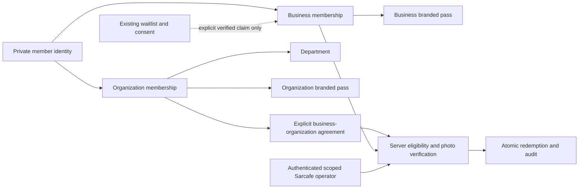

# 02 — Proposed hybrid identity architecture

Status: proposal for Fable implementation. Existing behavior is catalogued in [01](01-repository-audit.md). All new UI follows [10](10-glisse-design-contract.md). This extends Sarcafe in place and does not touch Ayeka Bar.

## Identity and authority are separate

A `customer_members` UUID identifies one person. An organization membership describes their approved affiliation; a business membership describes their relationship with a business. Separate branded passes attach to these memberships. **Neither membership creates a Sarcafe `staff` row, grants POS access, joins the scheduler, or changes employee-code login.**

The global identity core is a service-only correlation record. It is not a global directory available to business owners. Names, contact verification, consent and photographs have a scoped presentation/ownership context. A business sees only projections explicitly permitted by its membership or organization agreement. A future business receives no access from the legacy Sarcafe `isOp` predicate alone.

No automatic linking by phone, email, nickname or name. Waitlist deduplication is a collection rule, not proof of identity. A verified authenticated subject can intentionally link memberships after proving both contexts, or an authorized reviewer can process a documented correction. Ambiguous matches stay separate; do not build a bulk merge tool in this project. A later merge must preserve audit and revoke affected credentials.

## Proposed module and route layout (new, does not yet exist)

Keep pure rules under `src/lib/identity/`; place database/secret access under `src/lib/identity/server/` with `server-only`. New UI under `src/components/identity/` uses shared glass components. Use existing route-handler/validation/error patterns, without broad refactors.

| Surface | Proposed route family | Authority |
|---|---|---|
| Sarcafe administration | `/owner/members`, `/api/owner/members/*` | Full existing owner session AND explicit Sarcafe business scope |
| External department administration | `/benefits/manage`, `/api/benefits/manage/*` | Verified Supabase user + active scoped organization/department grant; does not require or confer staff access |
| Invited employee application | `/benefits/register`, `/api/benefits/register/*` | Single-purpose, short-lived registration session exchanged from an invitation |
| Staff verification | `/staff/benefits/scan`, `/api/benefits/verify`, `/api/benefits/redeem` | Active staff identity, authorized business/branch and scanner capability |
| New public membership | `/membership`, `/api/membership/*` | Business determined by trusted route mapping; enrollment gate; identity proof separate from typed contact details |
| Existing waitlist | `/loyaltysignup`, `/api/loyaltysignup`, `/api/kiosk/waitlist` | Preserve existing contracts; collection control is separate |
| Wallet protocol | `/api/wallet/*` | Provider protocol credentials or short-lived issuance delivery capability; no browser staff cookie assumption |

Add explicit middleware and QA route-guard entries for new paths. Avoid making `/benefits/*` inherit `/staff/*` middleware, which would exclude legitimate external department heads. An owner tool link never substitutes for API authorization. No broad public-route wildcard.

## Role and scope matrix

| Actor | Organization/department administration | Business controls | Verification/redemption | Private photos |
|---|---|---|---|---|
| Sarcafe owner, full session | Only organizations explicitly administered / agreed scope | Sarcafe scope; future businesses require explicit grant | Authorized Sarcafe branches | Justified scoped administration/verification |
| Organization admin | Own organization | None by implication | None by implication | Own organization's active applications/members |
| Department head | Invited department only; cannot grant own wider authority | None | None | Scoped applications, no bulk export |
| Sarcafe operator with scanner grant | None | None | Assigned business/branch; explicit action and current eligibility | One active verification result, minimal fields |
| Ordinary employee / schedule delegate | No new authority | None | None until explicitly authorized | None |
| Member / invite holder | Own application; no self-approval | Own membership view only | Cannot redeem by self-assertion | Own photo via authenticated context |
| Kiosk shared key / signed-out visitor | None | None | Never a staff identity | None |

Proposed conservative first release: management requires full Google session; scanner also requires full session plus explicit capability. Existing employee-code sessions retain their current access but gain no sensitive identity authority. If owner later wants quick-session scanning, it needs an explicit tested policy change, not a side effect of `isStaff`.

Bootstrap Sarcafe business access from authenticated existing owners only after resolving the fixed Sarcafe business/branch mapping. Do not map every present or future business to any legacy owner. Organization/department grants are stored and rechecked on each action. Self-created auth metadata is not authority.

## Main flows

1. **Organization setup:** owner establishes a business-organization agreement and scoped administrator; admin creates departments and a hashed, expiring department-head invite. Initial delivery is a copyable private link; no real email/SMS send is authorized.
2. **Department-head acceptance:** authenticate through existing Supabase Google infrastructure with a separate safe return path, bind the invitation to the verified subject/intended invitee, consume once, then create a scoped grant. A typed email never proves ownership. Existing staff callback behavior must remain unchanged.
3. **Employee registration:** a scoped invite creates a constrained registration session. Collect first/last name, nickname and private photograph; store pending application and versioned notice evidence. Authoritative department review approves/rejects, with actor/reason. Forwarded invite alone cannot approve employment. Editing identity-critical details after approval requires review again.
4. **Credential and Wallet:** approved active membership may receive a revocable opaque QR credential. Test Wallet adapters operate first; real issuance waits for credentials and explicit authorization. Organization and business passes have separate brand and credential scopes.
5. **Verification:** authenticated operator scans an opaque credential, server resolves its audience/membership, shows minimal scoped identity and photo, operator confirms visual match or rejects. No facial recognition. Server creates a short-lived verification context bound to operator, business, branch, membership and credential version. Camera and photo clear on completion/timeout/navigation.
6. **Benefits:** server recalculates current eligibility and pricing input, consumes the verification context and records redemption atomically. Deactivation/revocation/policy changes between scan and redeem must take effect. No client-provided discount value is trusted.
7. **Loyalty:** existing waitlist stays operational. Inactive membership scaffolding links a contact only after explicit proof/consent; enrolling does not infer marketing permission. Launch controls are enforced at write/read/worker boundaries. See [07](07-loyalty-launch-controls.md).

## Business decisions not invented

Discount percentages/amounts, eligible products and departments, stacking, daily limits, who funds discounts, cashier authority, and sale integration have not been supplied. Store draft policies only; no production benefit activates without owner configuration. Existing terminal totals may differ from portal totals. A recorded benefit is not proof that HYP applied a discount or that payment settled. FABLE-005 must expose the unresolved sale-attachment decision before a real rollout; synthetic tests can use known server-priced sales.

Employee photo retention, employee registration notice approval, organization administrators, Wallet issuer accounts/branding and distribution method require business input before their respective live steps. Local fixtures and disabled configuration work can proceed after readiness review.
